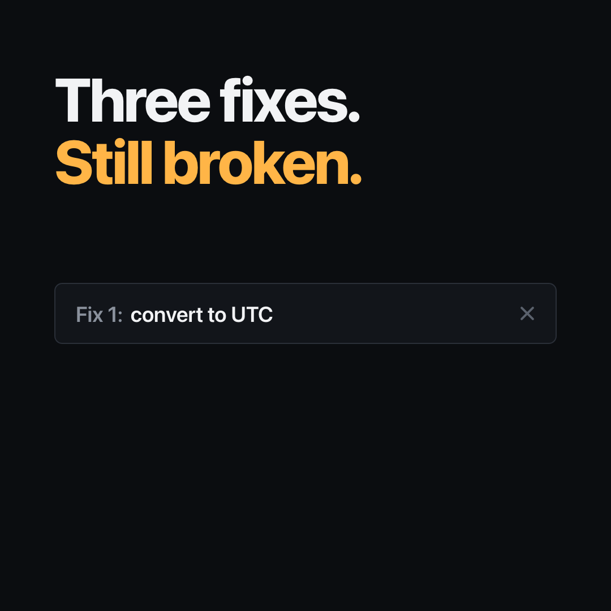
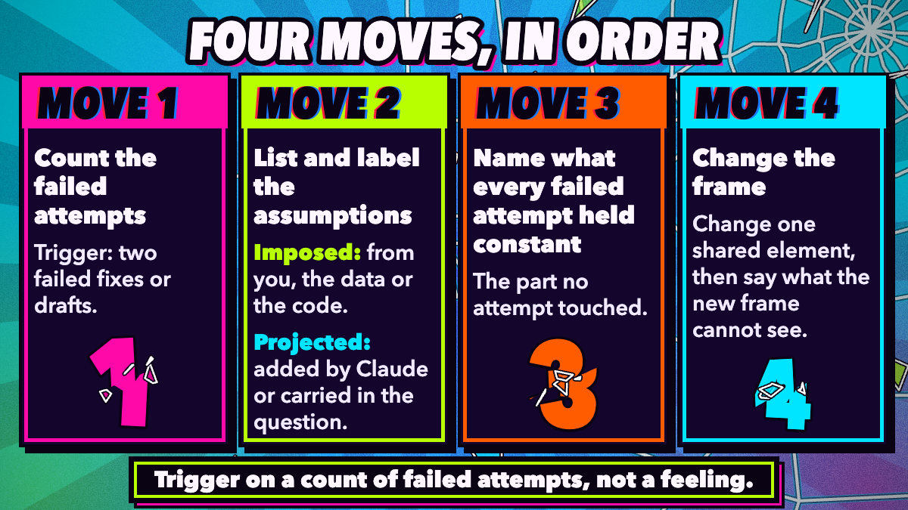
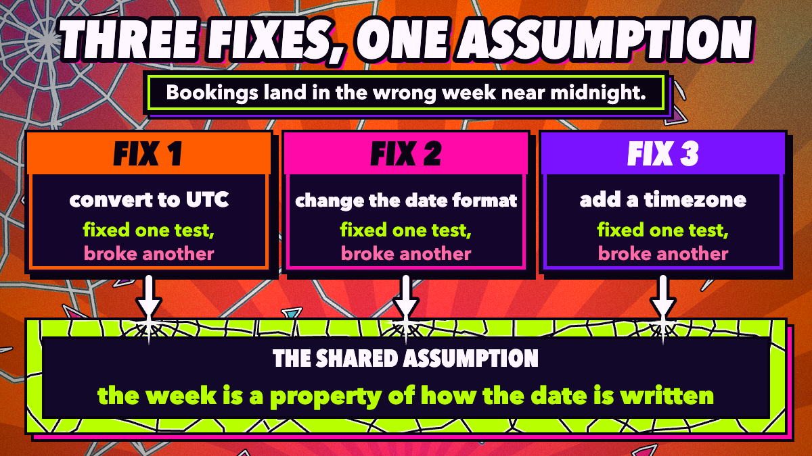
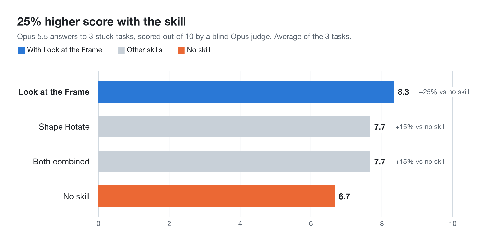
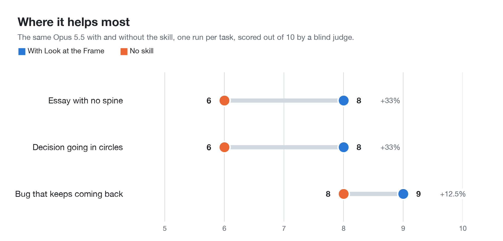

# Look at the Frame

When Claude has failed twice at the same fix or draft, this skill makes it find the assumption all the attempts shared and change it before trying again. Works in Claude Code and any agent that reads `SKILL.md` files.

[](assets/look-at-the-frame.mp4)

  

## Install

Run these two commands inside Claude Code:

```
/plugin marketplace add rightin2/look-at-the-frame
/plugin install look-at-the-frame@look-at-the-frame
```

<details>
<summary>Manual install</summary>

Copy the skill folder into your Claude Code skills folder:

```bash
git clone https://github.com/rightin2/look-at-the-frame.git
cp -r look-at-the-frame/skills/look-at-the-frame ~/.claude/skills/
```

</details>

## Try it

You do not need to call it by name. It is written to start when the conversation shows one of these signals:

- two fixes or drafts have already failed
- a list of special cases keeps growing and never settles
- your explanation keeps needing new exceptions to fit what you see
- one detail does not fit any of the explanations you are weighing
- you bring an either/or choice, or say you keep going back and forth

Prompts that set it off:

```
Bookings near midnight land in the wrong week. I've tried three fixes and each one breaks a different test.
```

```
I've rewritten this discussion section three times and it still has no spine.
```

```
I keep going back and forth on whether to take this role. Here are the pros and cons.
```

Claude replies with "Reframing", then works through the steps below before it offers another attempt. If you have only tried once, it carries on fixing as normal.

## How it works

The skill has seven steps. In short:



1. **Count the failed attempts.** It fires after two failures or one of the signals above, never on a hunch.
2. **List and label what every attempt took for granted,** checked against what the attempts actually did. Each assumption is marked imposed (you, the data or the code said it) or projected (Claude added it).
3. **Name what every failed attempt held constant.**
4. **Change one shared assumption,** preferably a projected one, and say which. Flipping to the opposite of the last attempt, such as stricter instead of looser, does not count, because both sides of a flip rest on the same assumptions.

Its final answer ends by naming the approach it took and what that approach would miss, and checks the answer against each gap. In the midnight bug test below, the gaps it named were clinics in different timezones and the nights the clocks change.

## Example: the midnight bug



Bookings land in the wrong week near midnight. Three fixes have been tried: convert to UTC, change the date format, add a timezone. Each one fixed one test and broke another. The assumption all three share is that the week is a property of how the date is written.

With the skill, Claude is told to:

- say "Reframing" and stop editing
- list the assumptions behind the three fixes, each marked imposed or projected
- name the one they share
- change it, say which, and only then make a fourth attempt

<details>
<summary>What a reply looks like</summary>

The opening of the skill's real answer to this task in the blind test:

> **Reframing.** Three different fixes have each moved the failure without removing it. That usually means they share an assumption that is wrong, so a fourth parsing tweak probably won't help.
>
> **Assumptions the three fixes share**
> - *Imposed (from you):* the input is CSVs of appointments, each booking gets a week, and bookings near midnight are misassigned.
> - *Projected (built into the fixes):* the bug is in how the time is parsed or converted.
> - *Projected:* a booking's timestamp is an absolute instant, so getting the instant right gives the right week.
> - *Projected:* there is one agreed definition of "which week", and the tests all encode it.

It went on to suggest a ten minute check: for each failing test, see whether the local date or the UTC date predicts the expected week. If neither does, the tests disagree with each other and no code can pass them all.

</details>

## Does it work?

In a blind test, Claude Opus scored answers to three tasks from four setups without knowing which setup wrote which: a bug that keeps coming back, an essay with no spine, and a decision that keeps going round. This skill averaged **8.3 out of 10**, the highest of the four and **25% higher** than no skill at **6.7**.

<picture>
  <source media="(prefers-color-scheme: dark)" srcset="assets/charts/average-dark.png">
  
</picture>

On the bug, the no-skill answer was close (8 against 9). Most of the gap came from the essay and the decision, each up 33%.

<picture>
  <source media="(prefers-color-scheme: dark)" srcset="assets/charts/by-task-dark.png">
  
</picture>

Every score and the judge's reason for it are in [`evals/results.json`](evals/results.json). That file also scores two other skill setups from the same project (both 7.7), which are not part of this repo. It is three tasks, run once each, scored by one model.

## What's inside

```
skills/look-at-the-frame/SKILL.md   the skill: when it fires, its seven steps, and where the idea comes from
.claude-plugin/plugin.json          plugin manifest for Claude Code
.claude-plugin/marketplace.json     lets /plugin marketplace add find it
evals/results.json                  blind test scores and the judge's reasons
assets/                             the video, its poster and the two diagrams
assets/charts/                      the result charts and make_charts.py, which draws them from evals/results.json
```

## Limits

- It needs failed attempts it can see in the conversation. On a first try it has nothing to count.
- The list of shared assumptions is Claude's own reading and can be wrong. It names an assumption; you still have to test it.
- It can fire too early and drop an approach that needed one more local fix.
- The imposed and projected labels are jargon. The test judge said they added friction for a busy reader.
- The evidence is three tasks scored by a model, not by people.

## Origin

The skill comes from John Vervaeke's lecture series *Awakening from the Meaning Crisis*. In the nine-dot puzzle, people fail because they imagine a square around the dots that the puzzle never draws. Kaplan and Simon's advice follows from that: when attempts keep failing, ask what you keep not changing. The rule against flipping to the opposite comes from his account of Siddhartha, who tried indulgence, then self-denial, and failed at both. As Vervaeke puts it, "When you negate something you are still framing it in the same way."

## Licence

MIT. See [LICENSE](LICENSE).
