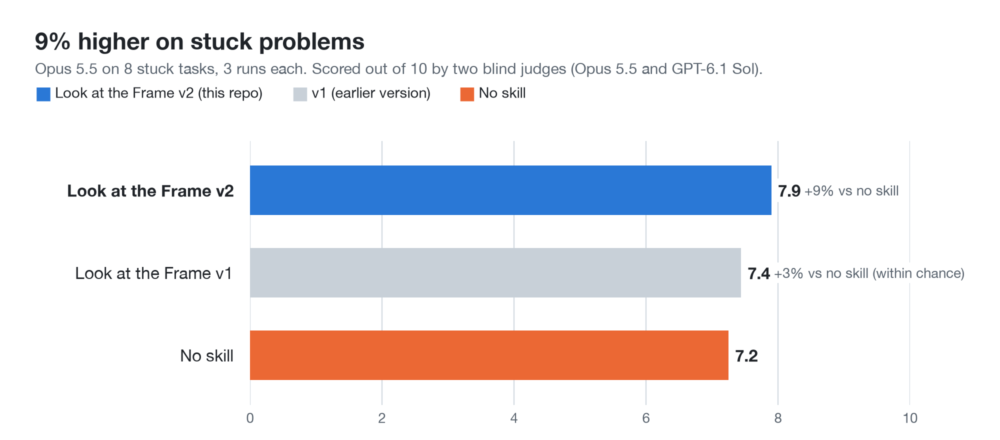

# Look at the Frame

When Claude has tried two or three versions of the same fix and none of them worked, this skill makes it find what every attempt kept the same and change that before trying again. Works in Claude Code and any agent that reads `SKILL.md` files.

[](assets/look-at-the-frame.mp4)

  

## Install

Run these two commands inside Claude Code:

```
/plugin marketplace add rightin2/look-at-the-frame
/plugin install look-at-the-frame@look-at-the-frame
```

<details>
<summary>Manual install</summary>

Copy the skill folder into your Claude Code skills folder:

```bash
git clone https://github.com/rightin2/look-at-the-frame.git
cp -r look-at-the-frame/skills/look-at-the-frame ~/.claude/skills/
```

</details>

## Try it

You do not need to call it by name. It starts only when the conversation shows two or more attempts that changed nothing and were variations on one approach: the same mechanism with different settings, or a list of special cases that keeps growing. On a first try, or a choice where nothing has failed yet, Claude answers as it normally would.

Prompts that set it off:

> Bookings near midnight land in the wrong week. I've tried converting to UTC, changing the date format and adding a timezone. Each one fixes one test and breaks another.

> I sent LinkedIn messages to 40 local GPs. I tried a long intro, a short one, adding my registration, then personalising the first line. Still a 5% reply rate and no referrals.

If the failed attempts were different in kind rather than variations on one, the companion skill [Heat Then Cool](https://github.com/rightin2/heat-then-cool) is the one that fits. The two never run together.

## How it works


Claude does this in its thinking:

1. **Name what every failed attempt kept the same,** pointing to each attempt. That shared assumption is what changes, not the wording of the answer.
2. **Change it by stepping back a level,** finding something that holds in every case, or borrowing from a distant field. Rearranging the same parts does not count.
3. **Refuse the opposite of the last attempt, or a midpoint between two failed ones,** unless it also changes the shared assumption. Swinging between two extremes usually means both share one.
4. **Ask for the missing fact** if no change of assumption works.

What you see is plain: the shared assumption in the first sentence, one line on why each attempt behaved as it did, the next attempt itself (code, draft or plan), and one quick check that confirms it or points elsewhere. No labels, no step names, and never longer than a plain answer.

## Example: GP referrals going nowhere

This is one of the test tasks, quoted in short in the second prompt above. Four rewrites of the same LinkedIn message all got about a 5% reply rate and no referrals.

<details>
<summary>What the reply looked like</summary>

The opening of the skill's real answer in the blind test, which both judges scored 9 out of 10:

> All four versions changed the message; none changed the channel or the person receiving it. Every attempt was a LinkedIn DM to an individual GP, and your own data suggests the problem is there: profiles with under 50 connections and no posts usually mean the owner rarely logs in, so most of your messages were probably never read.
>
> Why each attempt stayed flat:
> - **150-word intro:** Length wasn't the issue if it wasn't opened.
> - **50-word version:** Shorter, but it went to the same unopened inbox.
> - **Adding AHPRA and conditions:** Good content, but GPs who never saw it couldn't weigh it.
> - **Personalised line and lunch-and-learn:** The strongest offer, sent through the weakest pipe.

It went on to a practice manager phone script and a referral sheet, then a quick check: call five local clinics and ask how their GPs choose who to refer to. If the answer is "whoever's in our system", the plan holds. If the patient chooses, effort should move to being easy for patients to find.

</details>

## Does it work?

Claude Opus 5.5 answered 10 tasks it had never seen, 3 times each, with and without the skill: 8 stuck problems (bugs, writing, scheduling, outreach) and 2 ordinary requests where nothing had failed. Two judges from different model families, Opus 5.5 and OpenAI's GPT-6.1 Sol, scored every answer out of 10 without knowing which setup wrote it.

On the stuck problems the skill averaged **7.9 against 7.2 with no skill, 9% higher**. The 95% range for the gain is 0.25 to 1.08 points, so it is above chance, and both judges scored it higher. On the 2 ordinary requests it scored about the same as no skill (8.0 against 7.8), and its answers were no longer (516 words against 529).

<picture>
  <source media="(prefers-color-scheme: dark)" srcset="assets/charts/stuck-tasks-dark.png">
  
</picture>

It helped most on the problems about people and routines (the notes backlog, GP outreach, duplicated work) and least on the technical bugs. On one, a backup script that fails when scheduled, it scored lower than no skill.

<picture>
  <source media="(prefers-color-scheme: dark)" srcset="assets/charts/by-task-dark.png">
  
</picture>

**What changed since the first version.** An earlier small test (3 tasks, run once, one judge) put the first version 25% ahead. That did not hold up: on these 10 tasks the first version was only 3% ahead, within chance. Its answers were too long and printed their working. Version 2 applies [ten fixes](evals/v2-test/FIXES.md): it fires only on repeated failure, keeps its method in its thinking, caps length, and uses only facts the person gave. The companion skill, Heat Then Cool, scored higher again on the same tasks (14%).

Every score and the judges' reasons are in [`evals/v2-test/results.json`](evals/v2-test/results.json), with the tasks in [`tasks.json`](evals/v2-test/tasks.json). The first version and its small test are kept in [`evals/skill-v1.md`](evals/skill-v1.md) and [`evals/v1-small-test.json`](evals/v1-small-test.json).

## What's inside

```
skills/look-at-the-frame/SKILL.md   the skill: when it fires, what Claude does, what you see
.claude-plugin/plugin.json          plugin manifest for Claude Code
.claude-plugin/marketplace.json     lets /plugin marketplace add find it
evals/v2-test/                      the 10 test tasks, the results and the ten fixes
evals/skill-v1.md                   the first version of the skill
evals/v1-small-test.json            the earlier 3 task test of the first version
assets/                             the video, its poster and the diagram
assets/charts/                      the result charts and make_charts.py, which draws them from the results
```

## Limits

- It needs failed attempts it can see in the conversation. On a first try it has nothing to work from.
- The shared assumption is Claude's reading and can be wrong. Pointing to each attempt is the guard, and you still have to test the change.
- It can fire one fix too early and drop an approach that was nearly there.
- The ten fixes were drawn from what earlier judges praised and criticised, using the same scoring rules, so part of the gain may be learning what judges reward.
- The evidence is 8 stuck tasks and 2 ordinary ones, with Opus 5.5 answering and models judging, not people.

## Origin

The skill comes from John Vervaeke's lecture series *Awakening from the Meaning Crisis*. In the nine-dot puzzle, people fail because they imagine a square around the dots that the puzzle never draws. When attempts keep failing, ask what you keep not changing. The rule against flipping to the opposite comes from his account of Siddhartha, who tried indulgence, then self-denial, and failed at both. As Vervaeke puts it, "When you negate something you are still framing it in the same way."

## Licence

MIT. See [LICENSE](LICENSE).
